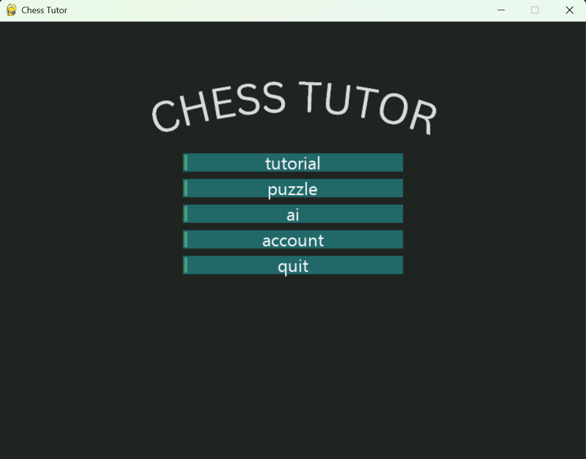
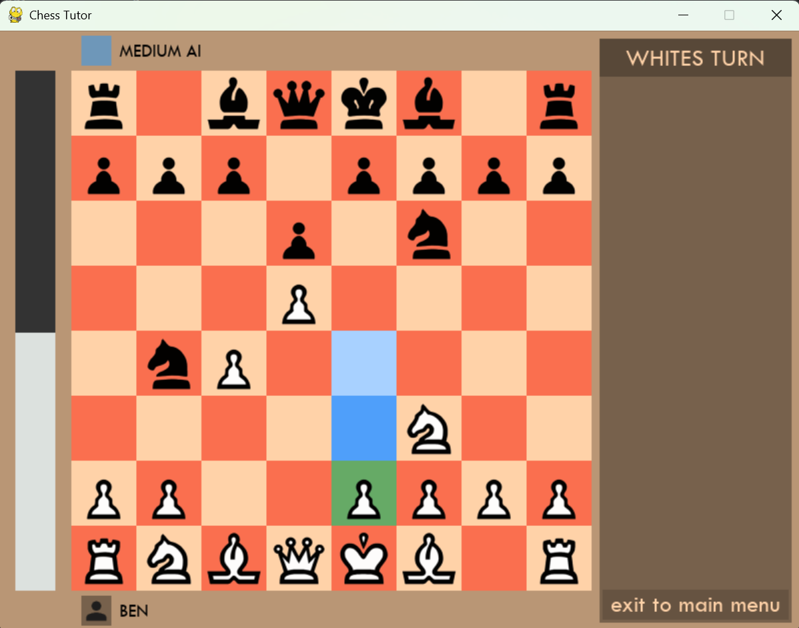
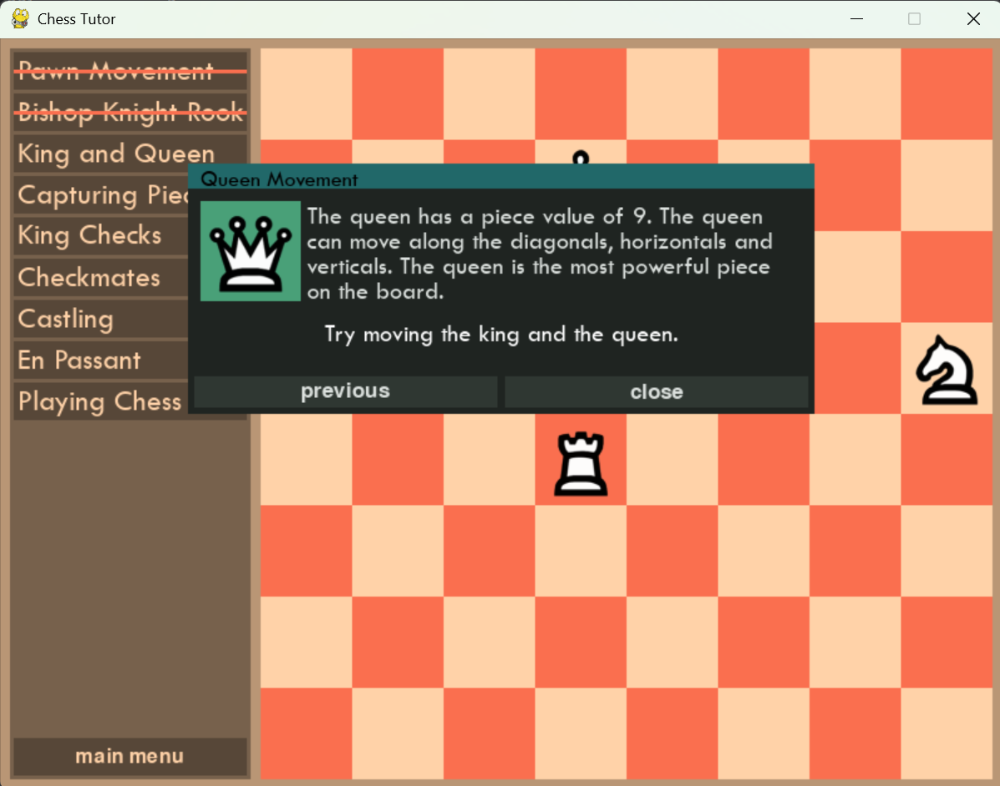

# Chess Tutor

An offline chess application for learning and practising chess, written in Python with Pygame. It has an interactive tutorial, adaptive puzzles and a computer opponent with three difficulty levels, with progress saved to a local account.





## Features

- **Tutorial mode:** guided stages that teach the pieces and rules. Moves are validated as you play.
- **Puzzle mode:** puzzles chosen from a JSON database to match your puzzle rating (within 100 points of it). Solving a puzzle raises your rating and failing one lowers it.
- **AI mode:** play against Easy, Medium or Hard computer opponents.
- **Accounts and progress tracking:** sign up and sign in, with tutorial, puzzle and AI progress stored in SQLite and shown on an account screen.
- **Fully offline:** no internet connection is needed for any mode.
- **Full rules:** legal move checking, check, checkmate, draws, castling, en passant and promotion, with FEN loading and PGN output.

## The AI

The user always plays as white against the AI which is playing with the black pieces.
The computer opponent is built from standard game-tree search techniques, with no neural network:

| Component | What it does |
|---|---|
| **Minimax with alpha-beta pruning** | Searches ahead through move sequences, assuming the opponent plays well, and prunes branches that can't change the result. |
| **Quiescence search** | Keeps searching through captures at the depth limit so the AI doesn't misjudge positions in the middle of an exchange (the horizon effect). |
| **Board evaluation** | Material values (pawn 100, knight 300, bishop 300, rook 500, queen 900) plus piece-square tables. The king's table changes in the endgame. |

The three difficulty levels give distinct play: in my test positions the levels often chose different moves, and the Easy level makes frequent blunders on purpose.
The search depth used for each level, Easy = depth 1, Medium = depth 2, Hard = depth 3 + quiescence
A depth of 3 with quiescence is shallow compared with real engines, but sufficient for a learning project.

## Architecture

A layered design separates the interface, the game rules, data access and storage:

```
User Interface (Pygame screens)  ->  Game logic (Game, Board, Rules, pieces)
                                          |
                           Data access (ActiveAccount, parameterised SQL)
                                          |
                          Storage (SQLite database + chess_puzzles.json)
```

- The board is a flat 1D list of squares, which keeps move generation and evaluation simple and fast.
- All database access goes through one module and uses parameterised queries.
- Puzzles live in `chess_puzzles.json` (ID, FEN, solution moves, rating), so new puzzles can be added without touching the code.
- Passwords are stored as a hash, not as plain text. The project uses a custom polynomial rolling hash, which gives obfuscation but isn't suitable for real-world security (see Limitations).

## Running it

Requires Python 3.12 or later on Windows (the only platform I tested).

```
pip install -r requirements.txt
python main.py
```

## Testing

I tested in four sprints against 40 written success criteria. Selected results:

| Test | Result |
|---|---|
| AI-generated moves that were legal | 100 / 100 |
| Easy AI blunders per game (10 games) | 7.2 on average |
| Medium AI vs an intermediate player (10 games) | 7 wins, 3 losses |
| Hard AI vs an advanced player (10 games) | 5 wins, 4 losses, 1 draw |
| Startup time | about 0.2 s |
| Frame rate (5 long sessions) | 22.1 FPS on average |

Of the 40 criteria, 38 were fully met and 2 partially met. The game results come from small samples (10 games each) with one or two players, so they show the levels are sensible, not that the ratings are accurate.

## Limitations and future work

- **No online play or learning:** the AI uses fixed search algorithms and doesn't learn from games.
- **Hard AI speed:** the hard level can be slow in complex positions. A time cap on its search is the main planned fix.
- **Password hashing:** the polynomial rolling hash is a learning exercise. A real application should use a salted, slow hash such as bcrypt or Argon2.
- **Content:** there is one tutorial, no undo button, no sound, and puzzles can't be filtered by theme.
- **Platform:** tested on Windows only.
- **Planned:** undo, more tutorial lessons, puzzle categories, themes and sound, and a post-game analysis board.

## Project layout

```
main.py             entry point
game.py             Game class: turns, moves, simulation
board.py            Board: FEN parsing, piece map
rules.py            check, checkmate, draws, castling, en passant
algorithms.py       evaluation, minimax, quiescence search
accountmanager.py   account and progress database access
screens.py          Pygame screens
pieces.py           object-oriented code for each piece
piecetables.py      position evaluation tables
screensettings.py   configuration of each screen
keyvariables.py     stores variables used across multiple files
chess_puzzles.json  puzzle database
```
